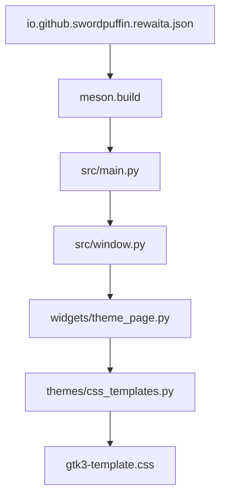

# SwordPuffin/Rewaita

> Application GNOME qui change l'apparence d'Adwaita en générant des thèmes GTK, sans effort.

## Le problème
Personnaliser les couleurs d'Adwaita (GTK3 et GTK4, Shell) oblige à éditer des feuilles de style à la main.

## Ce que ça fait vraiment
L'app GTK en Python applique des palettes (Nord, Dracula, etc.) en générant les feuilles de style GTK à partir de modèles. Elle s'utilise par interface ou ligne de commande (`--theme`, `--list`). Seule la version Flatpak est officiellement supportée ; AUR, openSUSE et Nix sont maintenus par des tiers.

## Comment c'est branché


## Essayer
```bash
flatpak install io.github.swordpuffin.rewaita
flatpak run io.github.swordpuffin.rewaita --list
flatpak run io.github.swordpuffin.rewaita --theme={theme name}
```

## Coût et pièges
Gratuit. Il faut donner à Flatpak l'accès en écriture à `gtk-3.0` et `gtk-4.0` ; la section des bogues connus est longue (thème qui reste après désinstallation, fenêtre vide). Licence GPL-3.0.

## Ce que ce n'est pas
Ce n'est pas un thème prêt à l'emploi pour tous les environnements : il cible GNOME et Adwaita.

## Alternatives
Aucune alternative nommée dans le README.

## Pour toi
À ignorer : retouche d'apparence de bureau Linux sans rapport avec la data ou le MLOps.

