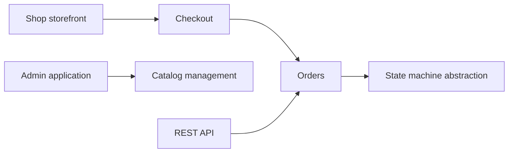

# Sylius/Sylius

> Open source e-commerce framework on Symfony, for PHP developers building custom shops.

## The problem
Ready-made e-commerce platforms adapt poorly to specific business needs.

## What it actually does
PHP framework organized around the storefront, catalog, cart, payment, orders, shipping and promotions, with an administration interface and a REST API. BDD testing culture (PHPUnit and Behat). The architecture shows a state machine abstraction with a Winzou adapter.

## How it is wired

## Trying it
No documented command. The README points to installation via Composer and the "Getting started" tutorial.

## Cost and gotchas
The core is free; Sylius Plus (multi-store, B2B, loyalty, SLA support) is a paid offering.

## What it is not
Not a ready-to-use shop: it is a development framework. The plugin catalog is a separate marketplace.

## Alternatives
- No alternative named in the README.

## For you
Ignore: PHP e-commerce, unrelated to data/AI.
