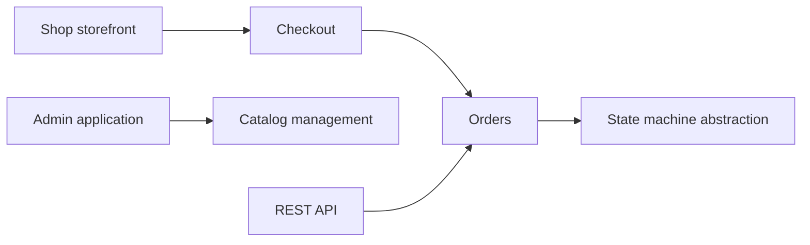

# Sylius/Sylius

> Framework e-commerce open source sur Symfony, pour développeurs PHP construisant des boutiques sur mesure.

## Le problème
Les plateformes e-commerce prêtes à l'emploi se plient mal à des besoins métier spécifiques.

## Ce que ça fait vraiment
Framework PHP organisé autour de la vitrine, du catalogue, du panier, du paiement, des commandes, de l'expédition et des promotions, avec une administration et une API REST. Culture de tests BDD (PHPUnit et Behat). L'architecture montre une abstraction de machine à états avec adaptateur Winzou.

## Comment c'est branché

## Essayer
Aucune commande documentée. Le README renvoie vers l'installation par Composer et le tutoriel « Getting started ».

## Coût et pièges
Le cœur est gratuit ; Sylius Plus (multi-boutique, B2B, fidélité, support SLA) est une offre payante.

## Ce que ce n'est pas
Pas une boutique prête à l'emploi : c'est un cadre de développement. Le catalogue de plugins est un marché séparé.

## Alternatives
- Aucune alternative nommée dans le README.

## Pour toi
À ignorer : e-commerce PHP, sans rapport avec la data/IA.

