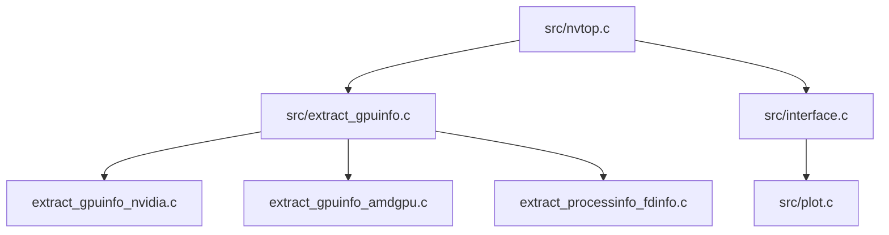

# Syllo/nvtop

> Terminal GPU monitor, htop-style, for NVIDIA, AMD, Intel and several accelerators.

## The problem
On a multi-GPU machine, finding out who is using what means chaining vendor-specific commands.

## What it actually does
Shows real-time utilization, memory, temperature, power and clocks for each GPU, with the processes using them. Supports AMD, Intel, NVIDIA, Apple (limited), Qualcomm Adreno, Ascend, Tenstorrent and others. F2 opens the configuration, F12 saves it. Process information goes through the kernel's fdinfo interface.

## How it is wired


## Trying it
```bash
sudo apt install nvtop
nvtop
man nvtop
```

## Cost and gotchas
Free. AMD processes require kernel 5.14 or later, Intel 5.19 or later, with CAP_PERFMON for full measurements. Under WSL2, do not reinstall the NVIDIA Linux drivers.

## What it is not
Neither a history-keeping tool nor a metrics exporter: it is an interactive display. It does not replace cluster monitoring.

## Alternatives
No alternative named in the README.

## For you
Adopt: a lightweight, multi-vendor tool to monitor training or inference GPUs, with no heavy dependency.
