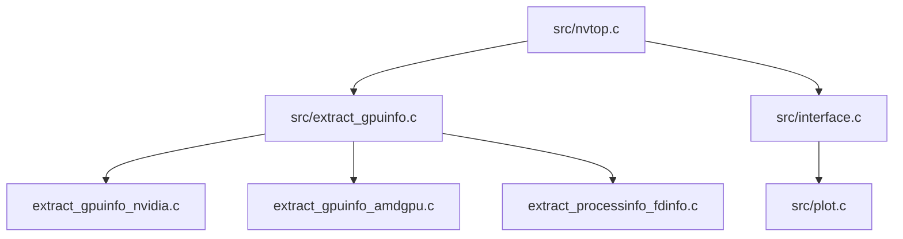

# Syllo/nvtop

> Moniteur de GPU en terminal, façon htop, pour NVIDIA, AMD, Intel et plusieurs accélérateurs.

## Le problème
Sur une machine à plusieurs GPU, savoir qui consomme quoi oblige à enchaîner des commandes propres à chaque fabricant.

## Ce que ça fait vraiment
Affiche en temps réel utilisation, mémoire, température, puissance et horloges de chaque GPU, avec les processus qui les utilisent. Gère AMD, Intel, NVIDIA, Apple (limité), Qualcomm Adreno, Ascend, Tenstorrent et d'autres. F2 ouvre la configuration, F12 la sauvegarde. Les infos de processus passent par l'interface fdinfo du noyau.

## Comment c'est branché


## Essayer
```bash
sudo apt install nvtop
nvtop
man nvtop
```

## Coût et pièges
Gratuit. Les processus AMD demandent un noyau 5.14 ou plus, Intel 5.19 ou plus, avec CAP_PERFMON pour les mesures complètes. Sous WSL2, ne pas réinstaller les pilotes NVIDIA Linux.

## Ce que ce n'est pas
Ni un outil d'historisation ni un exporteur de métriques : c'est un affichage interactif. Il ne remplace pas une supervision de cluster.

## Alternatives
Aucune alternative nommée dans le README.

## Pour toi
À adopter : un outil léger et multi-fabricants pour surveiller les GPU d'entraînement ou d'inférence, sans dépendance lourde.

