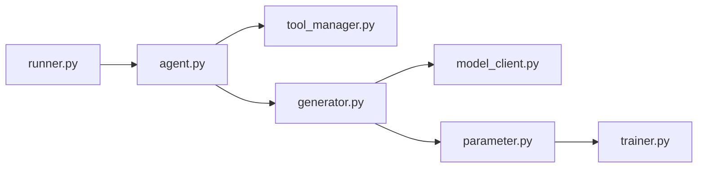

# SylphAI-Inc/AdalFlow

> PyTorch-like library for building LLM workflows (chatbot, RAG, agents) and optimizing their prompts.

## The problem
Writing and tuning prompts by hand for each model is slow and fragile.

## What it actually does
Provides provider-independent components (`Generator`, `Component`, `Agent`, `Runner`) and an optimization framework where prompts are `Parameter`s trained by textual gradients and few-shot demonstrations, with `Trainer`. The `Runner` executes the agent in synchronous, asynchronous or streaming mode; tracing and human validation are mentioned. The README compares with DSPy, Agent Lightning and TextGrad.

## How it is wired


## Trying it
```bash
pip install adalflow
```
Then set `OPENAI_API_KEY` and run the README's agent example (`Agent`, `Runner`, `runner.call(...)`).

## Cost and gotchas
Model calls are at your expense. The README examples use `eval` in a calculator tool: do not copy it as is into production. Last push on 2026-05-29.

## What it is not
Not a guarantee against DSPy: the README's comparisons come from the authors.

## Alternatives
- DSPy: declarative programming, prompt compiler.
- TextGrad: textual gradient descent.
- Agent Lightning: trains any agent (LangChain, AutoGen…).

## For you
Worth watching: a serious candidate if automatic prompt optimization is your need, to compare with DSPy on your own task before adopting.
