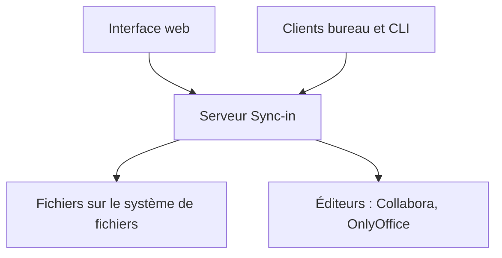

# Sync-in/server

> Self-hosted platform for file storage, synchronization and collaboration, for teams and individuals.

## The problem
Sharing and co-editing files without entrusting your data to a third-party service.

## What it actually does
Web interface with spaces, shares, guests, groups and fine-grained permissions, protected public links, full-text search, quotas and a trash bin. Online editing via Collabora, OnlyOffice, Euro-Office or draw.io, and WebDAV access. Local authentication, OIDC, LDAP and MFA; desktop clients and CLI. Files remain readable on disk.

## How it is wired
Simplified diagram based on the sheet, no diagram provided.

## Trying it
No command is documented in the provided README.

## Cost and gotchas
Free; the document editors are services to deploy separately. AGPL-3.0 license: obligations if the service is offered to third parties.

## What it is not
Not a data or AI tool. No quantified comparison or documented architecture in the provided README.

## Alternatives
No alternative named in the README.

## For you
Ignore: a file cloud unrelated to data, AI or MLOps, and under AGPL.
