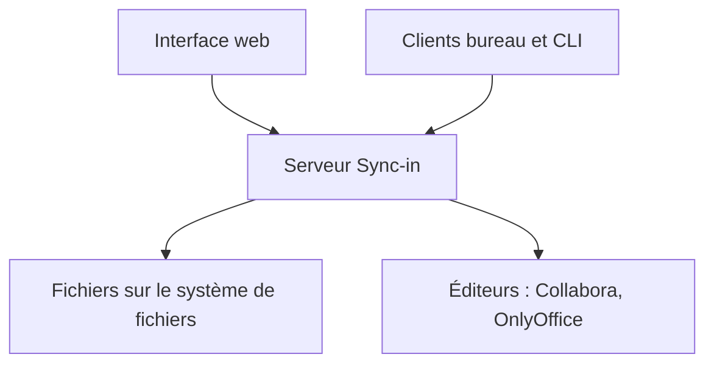

# Sync-in/server

> Plateforme auto-hébergée de stockage, synchronisation et collaboration sur fichiers, pour équipes et particuliers.

## Le problème
Partager et co-éditer des fichiers sans confier ses données à un service tiers.

## Ce que ça fait vraiment
Interface web avec espaces, partages, invités, groupes et permissions fines, liens publics protégés, recherche plein texte, quotas et corbeille. Édition en ligne via Collabora, OnlyOffice, Euro-Office ou draw.io, et accès WebDAV. Authentification locale, OIDC, LDAP et MFA ; clients bureau et CLI. Les fichiers restent lisibles sur le disque.

## Comment c'est branché
Schéma simplifié d'après la fiche, sans diagramme fourni.

## Essayer
Aucune commande n'est documentée dans le README fourni.

## Coût et pièges
Gratuit ; les éditeurs de documents sont des services à déployer à part. Licence AGPL-3.0 : obligations en cas de service proposé à des tiers.

## Ce que ce n'est pas
Pas un outil data ou IA. Sans comparaison chiffrée ni architecture documentée dans le README fourni.

## Alternatives
Aucune alternative nommée dans le README.

## Pour toi
À ignorer : un cloud de fichiers sans rapport avec la data, l'IA ou le MLOps, et sous AGPL.

