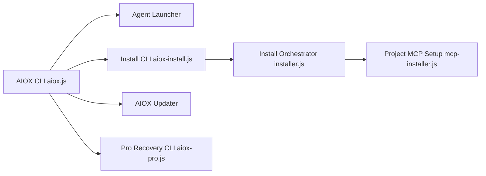

# SynkraAI/aios-core

> CLI framework that installs specialized AI agents (analyst, PM, dev, QA) into a project, driven from your IDE.

## The problem
AI-assisted development loses context between planning and code: generated tasks are generic and inconsistent from one agent to the next.

## What it actually does
Installs via `npx` agents (12 announced) and workflows into an existing or new project. Two phases: planning agents producing a PRD and architecture, then a Scrum Master agent that writes detailed "stories" consumed by dev and QA. Integrations described for Claude Code, Gemini CLI, Codex CLI, Cursor, Copilot, with very uneven hook parity. A paid module, AIOX Pro, is reserved for a cohort.

## How it is wired


## Trying it
```bash
npx aiox-core init meu-projeto
cd seu-projeto
npx aiox-core install
npx aiox-core doctor
```

## Cost and gotchas
The framework is free but relies on an AI assistant at your expense (subscription or API key). AIOX Pro (license, machineId) is reserved for members of a paid training.

## What it is not
Not a simple task runner, but not a standalone product either: without a compatible IDE, automation is reduced. The README is in Portuguese and the referenced documentation is not included. The npm package name is being migrated to `@aiox-squads/core`.

## Alternatives
No alternative named in the README (it only compares itself to "taskmaster" to say it is not one).

## For you
Worth watching: the planning → stories method is transferable to your projects, but the tool is coupled to in-house conventions, with a license to verify and a closed premium part.
