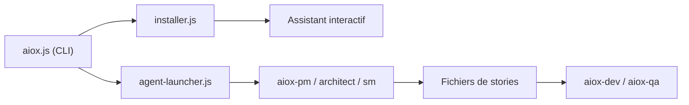

# SynkraAI/aiox-core

> Command-line framework that orchestrates specialized agents (PM, architect, dev, QA) for development.

## The problem
Coding agents lose context between planning and implementation, and produce generic tasks.

## What it actually does
`npx aiox-core` installer that deploys 12 agents and workflows into a project. Two phases: planning agents (PRD, architecture) then a Scrum Master who writes detailed "stories" consumed by dev and QA. An autonomous engine (ADE) adds git worktrees, a spec pipeline, resume on failure and a memory layer. IDE integrations are uneven: full hooks only under Claude Code. README mostly in Portuguese.

## How it is wired


## Trying it
```bash
npx aiox-core init meu-projeto
cd seu-projeto && npx aiox-core install
npx aiox-core doctor
```

## Cost and gotchas
Core is free; the AIOX Pro module is reserved for members of a paid program ("Cohort Advanced"), with a per-machine license. The repository's license is not identified by GitHub (the README mentions MIT): to be verified. The new package `@aiox-squads/core` succeeds the current name.

## What it is not
Not a simple task runner: it imposes a complete agile process. Advanced features depend on hooks, which are absent from Cursor and Copilot.

## Alternatives
Not documented in the README.

## For you
Ignore: a heavy, directive framework oriented toward software development, with a license to clarify and a paid part behind a cohort.
