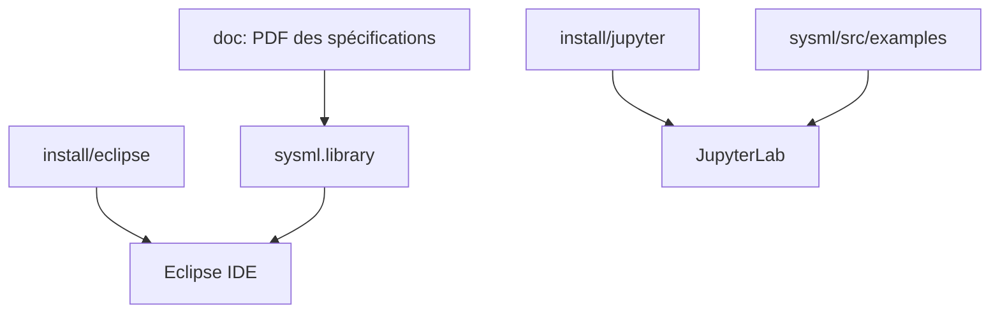

# Systems-Modeling/SysML-v2-Release

> Release repository for SysML v2: specifications, example models, libraries and Eclipse and Jupyter installers.

## The problem
Model-based systems engineering needs a standardized language and reference tools to try it out.

## What it actually does
Gathers the PDFs of the KerML 1.0, SysML 2.0 and Systems Modeling API 1.0 specifications (adopted by the OMG in June 2025), introductory presentations, example models, normative libraries in textual notation and XMI, and installers for Eclipse plugins and a Jupyter kernel.

## How it is wired


## Trying it
```bash
# Aucune commande dans le README : télécharger l'archive depuis la page Releases,
# puis lancer l'installeur du dossier install/eclipse ou install/jupyter.
```

## Cost and gotchas
Free, EPL-2.0 license for the code and models, CC BY 4.0 for the presentations. XMI is not a fully normative OMG format. The demonstration API is an external prototype.

## What it is not
Not a mature modeling tool on its own: it is the delivery of a reference. The development repositories are elsewhere.

## Alternatives
No alternative named in the README.

## For you
Ignore: systems engineering and MBSE, outside the data/AI field, except for the Jupyter kernel as a curiosity.
