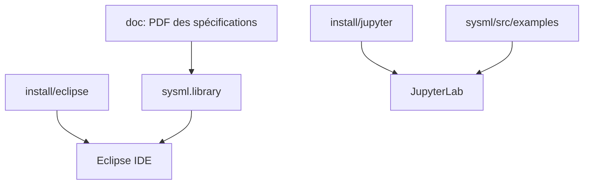

# Systems-Modeling/SysML-v2-Release

> Dépôt de publication de SysML v2 : spécifications, modèles d'exemple, bibliothèques et installeurs Eclipse et Jupyter.

## Le problème
L'ingénierie système par modèles a besoin d'un langage normalisé et d'outils de référence pour l'essayer.

## Ce que ça fait vraiment
Regroupe les PDF des spécifications KerML 1.0, SysML 2.0 et de l'API Systems Modeling 1.0 (adoptées par l'OMG en juin 2025), des présentations d'introduction, des exemples de modèles, des bibliothèques normatives en notation textuelle et XMI, et des installeurs pour des greffons Eclipse et un noyau Jupyter.

## Comment c'est branché


## Essayer
```bash
# Aucune commande dans le README : télécharger l'archive depuis la page Releases,
# puis lancer l'installeur du dossier install/eclipse ou install/jupyter.
```

## Coût et pièges
Gratuit, licence EPL-2.0 pour le code et les modèles, CC BY 4.0 pour les présentations. Le XMI n'est pas un format OMG pleinement normatif. L'API de démonstration est un prototype externe.

## Ce que ce n'est pas
Pas un outil de modélisation mûr à lui seul : c'est la mise à disposition d'une référence. Les dépôts de développement sont ailleurs.

## Alternatives
Aucune alternative nommée dans le README.

## Pour toi
Ignorer : ingénierie système et MBSE, hors du champ data/IA, sauf pour le noyau Jupyter à titre de curiosité.

