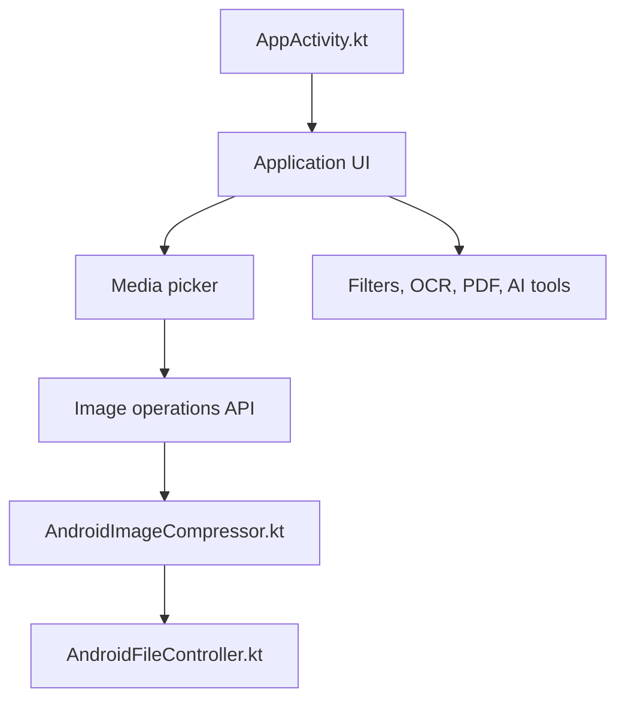

# T8RIN/ImageToolbox

> Android image editing application: filters, cropping, EXIF, OCR, PDF, background removal and AI models.

## The problem
Common mobile edits (compression, conversion, cropping, OCR, PDF) go through several apps, often loaded with ads or tracking.

## What it actually does
Bundles batch processing, over 600 filters, format conversion, EXIF editing, OCR (Tesseract or PaddleOCR), background removal (U2Net, RMBG, MobileSAM…), PDF tools, barcodes, image comparison and over 100 AI models (upscaling, denoising…). The FOSS version removes analytics and Crashlytics.

## How it is wired


## Trying it
```bash
git clone https://github.com/yourusername/ImageToolbox.git
./gradlew build
./gradlew run
```
(The README says to install dependencies with Gradle; the clone URL is an example, to be replaced. The normal route is to download the APK from the Releases.)

## Cost and gotchas
Free, donations requested in cryptocurrency. Android only. The "Market" variant bundles Google dependencies; AI models are downloaded separately.

## What it is not
It is not a Python library nor a service: it is a mobile application. The README is mostly a feature list, with little architecture information.

## Alternatives
No alternative named in the README.

## For you
Worth watching: interesting as a showcase of lightweight on-device models (segmentation, OCR, upscaling) on mobile, but not a production data tool.
