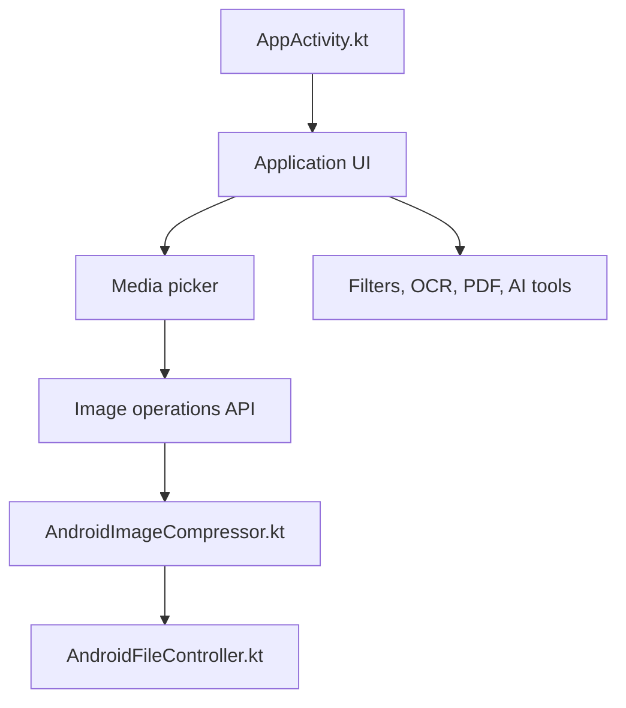

# T8RIN/ImageToolbox

> Application Android d'édition d'images : filtres, recadrage, EXIF, OCR, PDF, retrait de fond et modèles d'IA.

## Le problème
Les retouches courantes sur mobile (compression, conversion, recadrage, OCR, PDF) passent par plusieurs applications souvent chargées de publicité ou de pistage.

## Ce que ça fait vraiment
Regroupe traitement par lots, plus de 600 filtres, conversion de formats, édition EXIF, OCR (Tesseract ou PaddleOCR), retrait de fond (U2Net, RMBG, MobileSAM…), outils PDF, codes-barres, comparaison d'images et plus de 100 modèles d'IA (agrandissement, débruitage…). La version FOSS retire analytique et Crashlytics.

## Comment c'est branché


## Essayer
```bash
git clone https://github.com/yourusername/ImageToolbox.git
./gradlew build
./gradlew run
```
(Le README précise d'installer les dépendances avec Gradle ; l'URL de clonage est un exemple, à remplacer. La voie normale est de télécharger l'APK depuis les Releases.)

## Coût et pièges
Gratuit, dons demandés en cryptomonnaie. Android uniquement. La variante « Market » embarque des dépendances Google ; les modèles d'IA se téléchargent à part.

## Ce que ce n'est pas
Ce n'est pas une bibliothèque Python ni un service : c'est une application mobile. Le README est surtout une liste de fonctions, peu d'informations d'architecture.

## Alternatives
Aucune alternative nommée dans le README.

## Pour toi
À surveiller : intéressant comme vitrine de modèles légers embarqués (segmentation, OCR, upscaling) sur mobile, mais pas un outil de production data.

