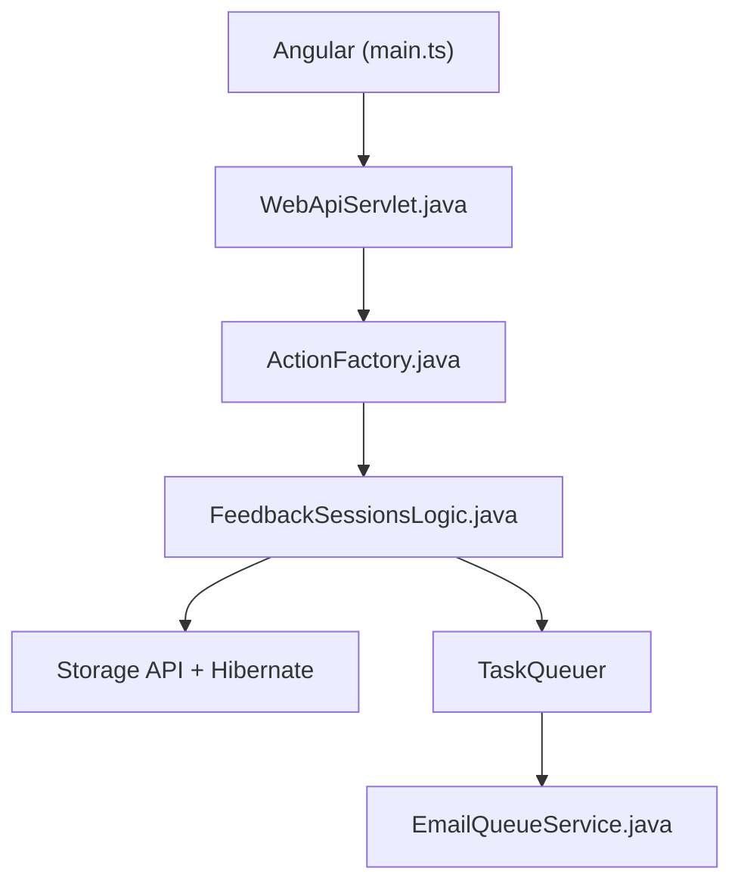

# TEAMMATES/teammates

> Online peer evaluation and student feedback tool, used by universities.

## The problem
Teachers need to collect peer feedback in team projects without an improvised spreadsheet.

## What it actually does
A Java server and an Angular application: feedback sessions, questions of several types, results with statistics, email reminders. Hibernate relational storage with Liquibase, tasks via Google Cloud Tasks, deployment on App Engine or Docker. The README is mostly an entry point for contributors.

## How it is wired


## Trying it
```bash
# No command documented in the README: see the developer documentation.
```

## Cost and gotchas
The public service is free for teachers. Self-hosting it requires Java, Gradle, Node, a relational database and mail services.

## What it is not
Not an automatic grading or analysis tool: it collects feedback.

## Alternatives
No alternative named in the README.

## For you
Ignore: Java and Angular educational application, no use for a data / AI / MLOps profile.
