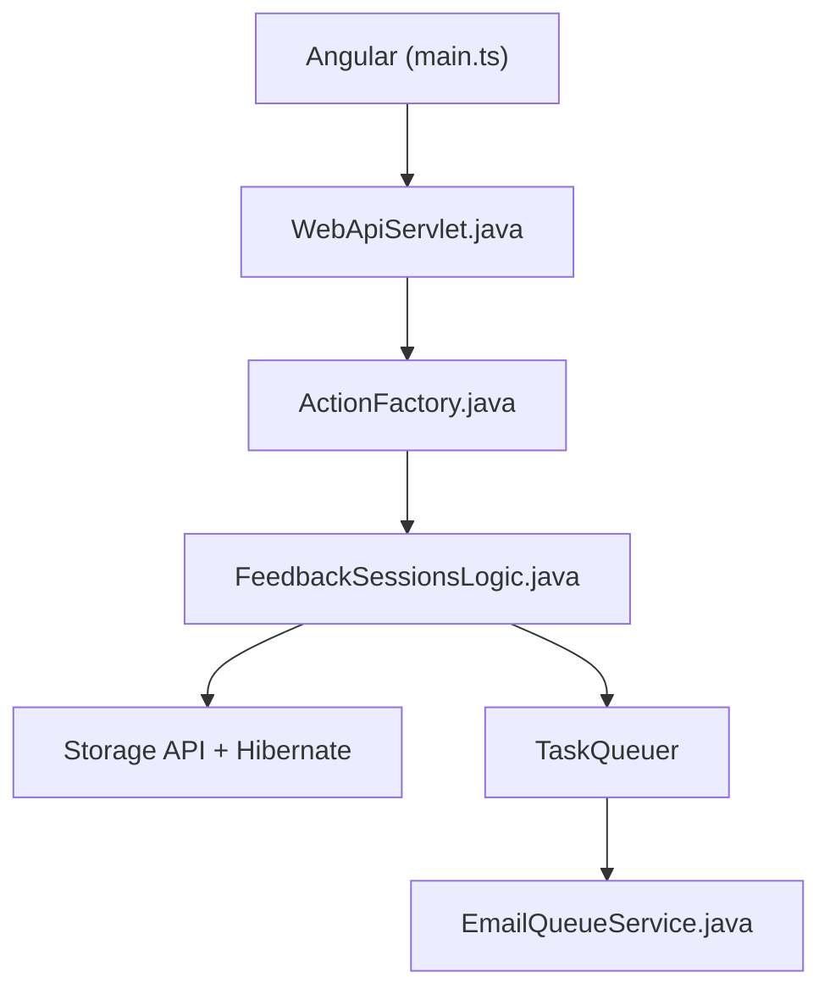

# TEAMMATES/teammates

> Outil en ligne d'évaluation par les pairs et de retours étudiants, utilisé par des universités.

## Le problème
Les enseignants doivent collecter des retours de pairs dans des projets d'équipe sans tableur improvisé.

## Ce que ça fait vraiment
Serveur Java et application Angular : sessions de feedback, questions de plusieurs types, résultats par statistiques, rappels par e-mail. Stockage relationnel Hibernate avec Liquibase, tâches via Google Cloud Tasks, déploiement sur App Engine ou Docker. Le README est surtout un point d'entrée pour contributeurs.

## Comment c'est branché


## Essayer
```bash
# Aucune commande documentée dans le README : voir la documentation développeur.
```

## Coût et pièges
Le service public est gratuit pour les enseignants. L'héberger soi-même demande Java, Gradle, Node, une base relationnelle et des services de mail.

## Ce que ce n'est pas
Pas un outil de notation automatique ni d'analyse : il collecte des retours.

## Alternatives
Aucune alternative nommée dans le README.

## Pour toi
À ignorer : application pédagogique Java et Angular, sans usage pour un profil data / IA / MLOps.

