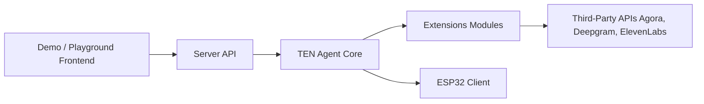

# TEN-framework/TEN-Agent

> Open-source framework for real-time multimodal conversational agents, mainly voice.

## The problem
Building a low-latency voice assistant requires assembling real-time transport, STT, LLM, TTS and turn-taking detection.

## What it actually does
A Go core loads extensions (ASR, LLM, TTS) configured by manifest and property.json; a server exposes the APIs and two Next.js frontends. Examples provided: voice assistant (RTC or WebSocket), diarization, avatars, SIP call, transcription, ESP32 board. A web designer (TMAN) sets the keys.

## How it is wired


## Trying it
```bash
cd ai_agents
cp ./.env.example ./.env
docker compose up -d
docker exec -it ten_agent_dev bash
cd agents/examples/voice-assistant
task install
task run
```

## Cost and gotchas
The quick start requires Agora (App ID and certificate), OpenAI, Deepgram and ElevenLabs. Build takes 5 to 8 minutes. At least three third-party accounts.

## What it is not
Not a local alternative: the default chain depends on paid cloud services.

## Alternatives
- No alternative named in the README.

## For you
Worth watching: only useful if you are building real-time voice; the cost in third-party accounts is high for a simple trial.
