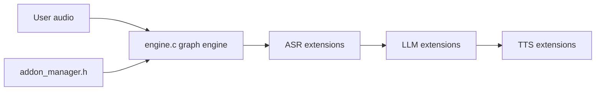

# TEN-framework/ten-framework

> Open source framework for real-time multimodal conversational agents (voice, avatars, SIP).

## The problem
A real-time voice assistant requires chaining recognition, an LLM and synthesis with low latency.

## What it actually does
A runtime composes extensions (STT, LLM, TTS, tools) into graphs. The examples cover a voice assistant (RTC or WebSocket), transcription, diarization, lip-synced avatars, SIP calls, an ESP32-S3 board. The ecosystem includes TEN VAD and TEN Turn Detection.

## How it is wired


## Trying it
```bash
cd ai_agents
cp ./.env.example ./.env
docker compose up -d
docker exec -it ten_agent_dev bash
cd agents/examples/voice-assistant
task install
task run
```

## Cost and gotchas
Agora keys (App ID and certificate), OpenAI, Deepgram and ElevenLabs for the example. Docker, Node 18, 2 cores and 4 GB of RAM minimum. First build takes 5 to 8 min. License not identified.

## What it is not
It is not an LLM: it orchestrates paid third-party services. The README does not detail the license model.

## Alternatives
Not documented: the README names no alternative.

## For you
Worth watching: useful for prototyping a real-time voice agent, but it stacks several paid services and a license to verify.
