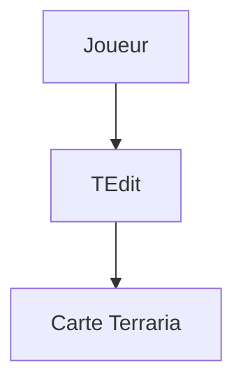

# TEdit/Terraria-Map-Editor

> Free standalone map editor for Terraria, for players and world builders.

## The problem
Editing a Terraria world without going through the game itself.

## What it actually does
The very short README describes a map editor "almost like Paint" with links to documentation, Discord, a development blog, downloads and Crowdin translations. Nothing more is documented.

## How it is wired
Simplified schema based on the sheet, no diagram provided.

## Trying it
No command documented in the README: downloading goes through the Download links and GitHub Releases.

## Cost and gotchas
Free. License present but not identified by GitHub: to verify. Prerequisite details not documented.

## What it is not
Not a data or AI tool: a game world editor.

## Alternatives
No alternative named in the README.

## For you
Ignore: a game map editor unrelated to your field, and the README is too thin to judge further.
