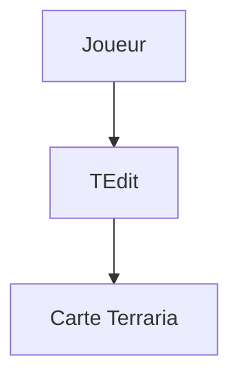

# TEdit/Terraria-Map-Editor

> Éditeur de cartes autonome et libre pour Terraria, pour joueurs et créateurs de mondes.

## Le problème
Modifier un monde Terraria sans passer par le jeu lui-même.

## Ce que ça fait vraiment
Le README, très court, indique un éditeur de cartes « presque comme Paint » avec liens vers documentation, Discord, blog de développement, téléchargements et traductions Crowdin. Rien de plus n'est documenté.

## Comment c'est branché
Schéma simplifié d'après la fiche, sans diagramme fourni.

## Essayer
Aucune commande documentée dans le README : le téléchargement passe par les liens Download et GitHub Releases.

## Coût et pièges
Gratuit. Licence présente mais non identifiée par GitHub : à vérifier. Détails de prérequis non documentés.

## Ce que ce n'est pas
Pas un outil de données ni d'IA : un éditeur de mondes de jeu.

## Alternatives
Aucune alternative nommée dans le README.

## Pour toi
À ignorer : éditeur de cartes de jeu sans lien avec ton métier, et README trop pauvre pour juger plus.

