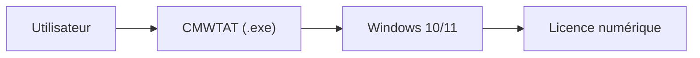

# TGSAN/CMWTAT_Digital_Edition

> C# tool that activates Windows 10 and 11 through a digital license, whose official website was compromised.

## The problem
Activating Windows without a hand-typed product key, according to the README, via a digital entitlement.

## What it actually does
It activates Windows 10 and 11 with a digital license. The README is mostly a security notice: the official website was hacked and download links replaced with ZIPs containing malicious `.msi` installers. GitHub downloads are not confirmed affected.

## How it is wired
Simplified diagram based on the sheet, no diagram provided.

## Trying it
No command documented in the provided part of the README.

## Cost and gotchas
Free. A normal download is a single `.exe` or a ZIP containing a single `.exe`: an `.msi` must not be run. A license is present but not identified by GitHub.

## What it is not
Not a tool of proven trustworthiness: the website intrusion is recent (August 2026) and the investigation continues. Use and legality of an activation are your responsibility.

## Alternatives
No alternative named in the README.

## For you
Ignore: a Windows activation tool outside your field, with a distribution-chain security incident.
