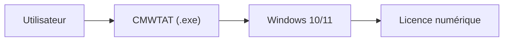

# TGSAN/CMWTAT_Digital_Edition

> Outil C# d'activation de Windows 10 et 11 par licence numérique, dont le site officiel a été compromis.

## Le problème
Activer Windows sans clé produit saisie à la main, selon le README, via un droit numérique.

## Ce que ça fait vraiment
Il active Windows 10 et 11 avec une licence numérique. Le README contient surtout une annonce de sécurité : le site officiel a été piraté et des liens de téléchargement remplacés par des ZIP contenant des installeurs `.msi` malveillants. Les téléchargements GitHub ne sont pas confirmés touchés.

## Comment c'est branché
Schéma simplifié d'après la fiche, sans diagramme fourni.

## Essayer
Aucune commande documentée dans la partie fournie du README.

## Coût et pièges
Gratuit. Un téléchargement normal est un seul `.exe` ou un ZIP contenant un seul `.exe` : un `.msi` ne doit pas être lancé. Licence présente mais non identifiée par GitHub.

## Ce que ce n'est pas
Pas un outil de confiance prouvée : l'intrusion du site est récente (août 2026) et l'enquête continue. Usage et légalité d'une activation sont à ta charge.

## Alternatives
Aucune alternative nommée dans le README.

## Pour toi
À ignorer : outil d'activation Windows hors de ton métier, avec un incident de sécurité de la chaîne de distribution.

