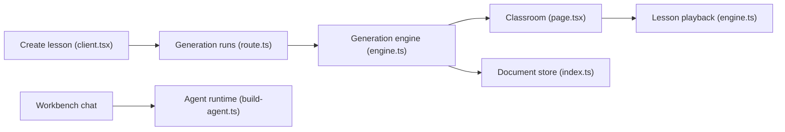

# THU-MAIC/OpenMAIC

> Platform that turns a topic or documents into an interactive classroom run by AI teacher agents.

## The problem
Preparing a course (slides, quizzes, simulations, exercises) by hand takes hours. Typical AI tutors remain a plain chat with no scene or whiteboard.

## What it actually does
- Generates a course server-side: slides, quizzes, HTML simulations, project-based learning (PBL).
- Teacher and classmate agents speak (TTS), draw on a whiteboard, and discuss live.
- Exports to .pptx, to a single offline .html, or to a classroom ZIP.
- An optional agent "workbench" (24 built-in skills) builds and edits courses; courses are stored in PostgreSQL.

## How it is wired


## Trying it
```bash
git clone https://github.com/THU-MAIC/OpenMAIC.git
cd OpenMAIC
pnpm install
cp .env.example .env.local
cp openmaic.example.yml openmaic.yml
pnpm db:up
pnpm dev
# ou : docker compose up --build
```

## Cost and gotchas
At minimum one key (the README cites `OPENAI_API_KEY`); "all modes" use (image, video, TTS, web search) multiplies the billed providers. Node >= 22.19, pnpm >= 10 and PostgreSQL 16 are required; without `DATABASE_URL` the server refuses to start. Without `ACCESS_CODE`, any visitor to the port owns the library.

## What it is not
Not an LMS or a hosted service: it is a long-running server you host yourself (Vercel is no longer supported since 1.2.0). No guarantee of pedagogical accuracy: the content comes from the models you plug in. README truncated in this block: the rest (deep interactive mode) was not read.

## Alternatives
No alternative named in the README as read.

## For you
Worth watching: the model "slots" configuration and the agent runtime are instructive for an AI profile, but deployment (Postgres, multiple keys) is heavy for use outside education.
