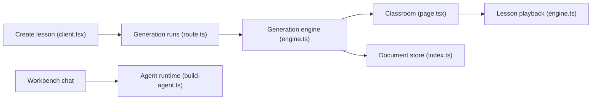

# THU-MAIC/OpenMAIC

> Plateforme qui transforme un sujet ou des documents en classe interactive animée par des agents IA enseignants.

## Le problème
Préparer un cours (slides, quiz, simulations, exercices) à la main prend des heures. Les tuteurs IA classiques restent un simple chat sans scène ni tableau.

## Ce que ça fait vraiment
- Génère côté serveur un cours : slides, quiz, simulations HTML, apprentissage par projet (PBL).
- Des agents enseignants et camarades parlent (TTS), dessinent sur un tableau blanc, discutent en direct.
- Exporte en .pptx, en un .html hors ligne ou en ZIP de classe.
- Un « workbench » agent optionnel (24 skills intégrés) construit et édite les cours ; les cours sont stockés dans PostgreSQL.

## Comment c'est branché


## Essayer
```bash
git clone https://github.com/THU-MAIC/OpenMAIC.git
cd OpenMAIC
pnpm install
cp .env.example .env.local
cp openmaic.example.yml openmaic.yml
pnpm db:up
pnpm dev
# ou : docker compose up --build
```

## Coût et pièges
Au minimum une clé (le README cite `OPENAI_API_KEY`) ; l'usage « tous modes » (image, vidéo, TTS, recherche web) multiplie les fournisseurs facturés. Node >= 22.19, pnpm >= 10 et PostgreSQL 16 requis ; sans `DATABASE_URL` le serveur refuse de démarrer. Sans `ACCESS_CODE`, tout visiteur du port possède la bibliothèque.

## Ce que ce n'est pas
Pas un LMS ni un service hébergé : c'est un serveur long à héberger soi-même (Vercel n'est plus supporté depuis 1.2.0). Pas de garantie de justesse pédagogique : le contenu vient des modèles que tu branches. README tronqué dans ce bloc : la suite (mode interactif profond) n'a pas été lue.

## Alternatives
Aucune alternative nommée dans le README lu.

## Pour toi
À surveiller : la config par « slots » de modèles et le runtime d'agents sont instructifs pour un profil IA, mais le déploiement (Postgres, multi-clés) est lourd pour un usage hors pédagogie.

