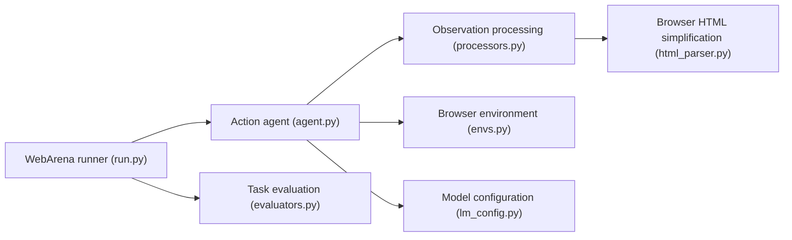

# THUDM/AutoWebGLM

> Official implementation of a web-browsing agent driven by ChatGLM3-6B, with a bilingual benchmark.

## The problem
Web-browsing agents handle long, complex HTML pages poorly in real-world conditions.

## What it actually does
An evaluation repository: WebArena and MiniWob++ runners that build a prompt from the browser state, generate and parse an action, apply it, then evaluate the trajectory. It contains the HTML simplification algorithm. The README also describes hybrid human-AI training, reinforcement learning and the AutoWebBench benchmark, but the repository does not expose the training pipeline.

## How it is wired


## Trying it
```bash
python eval.py [result_path]
```
Inference points to ChatGLM3-6B; the WebArena and MiniWob++ environments have their own READMEs.

## Cost and gotchas
Free, but you need a GPU for ChatGLM3-6B and modified environments (WebArena, MiniWob++). The last push dates from September 2024.

## What it is not
Not a ready-to-use agent: it is the evaluation code of a research paper. The announced training pipeline is not in the repository.

## Alternatives
No alternative named in the README.

## For you
Ignore: a research repository frozen since 2024, readable for the HTML simplification algorithm but with no directly usable path.
