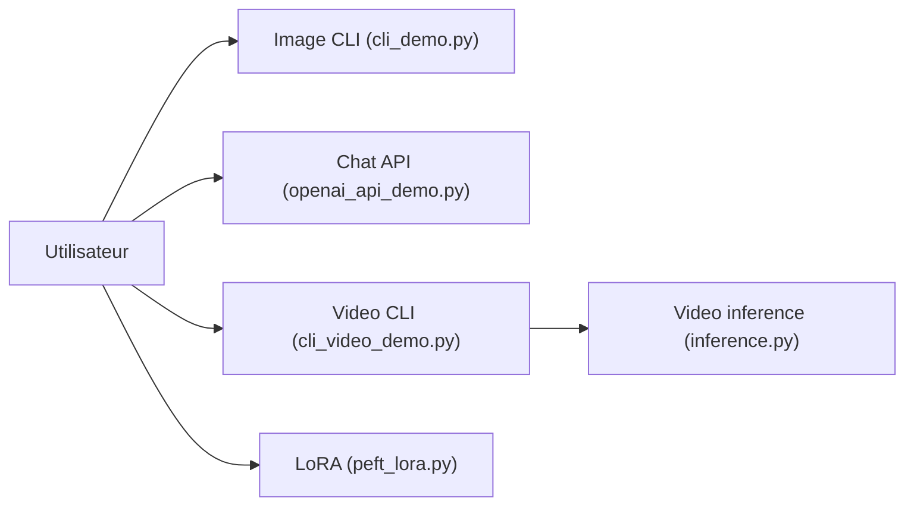

# THUDM/CogVLM2

> Open vision-language models (image and video) based on Llama-3-8B, with inference and fine-tuning demos.

## The problem
Understanding images, documents and videos with an open model, without a proprietary API.

## What it actually does
- Four models: 19B English chat, 19B Chinese-English chat, video chat and video base (based on Meta-Llama-3-8B-Instruct).
- Image: 8K context, resolution up to 1344×1344. Video: 24 frames at 224×224, 2K context.
- Folders `basic_demo` (CLI, multi-GPU, chainlit web, OpenAI-format API server), `finetune_demo` (PEFT), `video_demo` (CLI, REST API, Gradio).
- Int4 via `--quant 4`, about 16 GB of memory.

## How it is wired


## Trying it
```bash
# Aucune commande complète dans le README fourni.
# Seule l'option --quant 4 est citée (démos basic_demo et video_demo).
```

## Cost and gotchas
Free, but a GPU and a lot of memory are needed (19B; Int4 about 16 GB). Last push in March 2025; 60 open issues. The license of the weights is not specified in the README.

## What it is not
Not a ready-to-use service: a repository of demos. The benchmarks are the authors' own, compared against models of the time (2024).

## Alternatives
InternVL-1.5 and LLaVA-NeXT (compared in the README's benchmark table).

## For you
Ignore: model from May 2024 and a repository frozen since March 2025; prefer a recent VLM unless you specifically need this video model.
