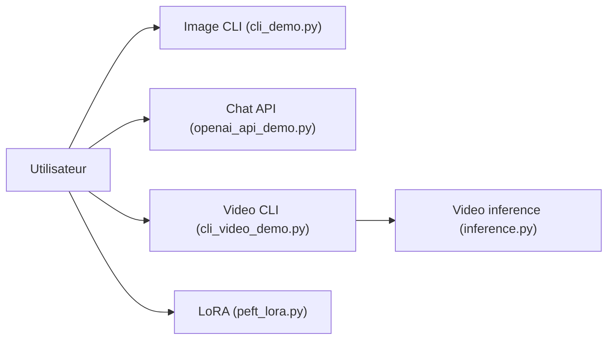

# THUDM/CogVLM2

> Modèles ouverts de vision-langage (image et vidéo) basés sur Llama-3-8B, avec démos d'inférence et de fine-tuning.

## Le problème
Comprendre des images, documents et vidéos avec un modèle ouvert, sans API propriétaire.

## Ce que ça fait vraiment
- Quatre modèles : chat 19B anglais, chat 19B chinois-anglais, vidéo chat et vidéo base (base Meta-Llama-3-8B-Instruct).
- Image : contexte 8K, résolution jusqu'à 1344×1344. Vidéo : 24 images en 224×224, contexte 2K.
- Dossier `basic_demo` (CLI, multi-GPU, web chainlit, serveur API au format OpenAI), `finetune_demo` (PEFT), `video_demo` (CLI, API REST, Gradio).
- Int4 via `--quant 4`, environ 16 Go de mémoire.

## Comment c'est branché


## Essayer
```bash
# Aucune commande complète dans le README fourni.
# Seule l'option --quant 4 est citée (démos basic_demo et video_demo).
```

## Coût et pièges
Gratuit, mais GPU et mémoire importants (19B ; Int4 environ 16 Go). Dernier push en mars 2025 ; 60 issues ouvertes. La licence des poids n'est pas précisée dans le README.

## Ce que ce n'est pas
Pas un service prêt à l'emploi : un dépôt de démos. Les benchmarks sont ceux des auteurs, comparés à des modèles de l'époque (2024).

## Alternatives
InternVL-1.5 et LLaVA-NeXT (comparés dans le tableau de benchmarks du README).

## Pour toi
À ignorer : modèle de mai 2024 et dépôt gelé depuis mars 2025 ; préfère un VLM récent sauf besoin précis de ce modèle vidéo.

