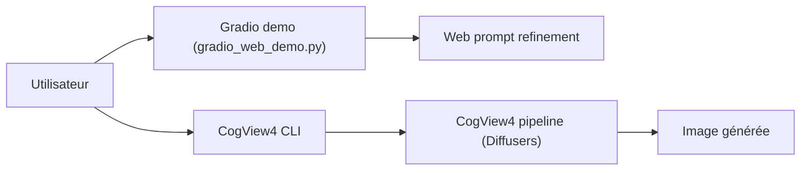

# THUDM/CogView4

> CogView4 and CogView3-Plus text-to-image models with inference scripts and prompt optimization.

## The problem
Generating images with an open model that understands Chinese and English and renders legible text.

## What it actually does
- CogView4-6B: GLM-4-9B encoder, prompts up to 1,024 tokens, Chinese and English; CogView3-Plus-3B: T5-XXL, English, 224 tokens.
- Inference via Diffusers (BF16 or FP32 only), Gradio demo, INT8 and int4 versions of the encoder.
- `prompt_optimize.py` script that rewrites prompts via an LLM (Zhipu API).
- No fine-tuning code here: points to CogKit and finetrainers; ControlNet not done.

## How it is wired


## Trying it
```bash
cd inference
python prompt_optimize.py --api_key "Zhipu AI API Key" --prompt {your prompt} --base_url "https://open.bigmodel.cn/api/paas/v4" --model "glm-4-plus" --cogview_version "cogview4"
```
```python
from diffusers import CogView4Pipeline
pipe = CogView4Pipeline.from_pretrained("THUDM/CogView4-6B", torch_dtype=torch.bfloat16).to("cuda")
```

## Cost and gotchas
GPU memory: 33 to 39 GB without offload, about 20 GB with CPU offload, 13 to 14 GB with a 4-bit encoder; 32 GB of RAM recommended. Prompt optimization requires a Zhipu key. Last push in March 2025.

## What it is not
Not a training tool nor ControlNet (not in the repository). The benchmarks are published by the authors.

## Alternatives
In the README tables: SD3-Medium, Flux.1-dev, SDXL, DALL-E 3 (compared, not presented as alternatives).

## For you
Ignore: repository frozen since March 2025, GPU-hungry; prefer a more recent image model unless you need Chinese text rendering.
