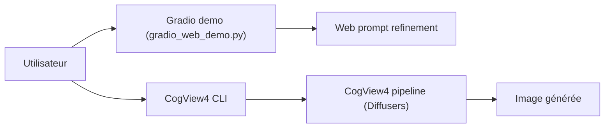

# THUDM/CogView4

> Modèles texte-vers-image CogView4 et CogView3-Plus avec scripts d'inférence et optimisation de prompt.

## Le problème
Générer des images avec un modèle ouvert qui comprend le chinois et l'anglais et rend du texte lisible.

## Ce que ça fait vraiment
- CogView4-6B : encodeur GLM-4-9B, prompts jusqu'à 1 024 tokens, chinois et anglais ; CogView3-Plus-3B : T5-XXL, anglais, 224 tokens.
- Inférence via Diffusers (BF16 ou FP32 seulement), démo Gradio, versions INT8 et int4 de l'encodeur.
- Script `prompt_optimize.py` qui réécrit les prompts via un LLM (API Zhipu).
- Pas de code de fine-tuning ici : renvoi vers CogKit et finetrainers ; ControlNet non fait.

## Comment c'est branché


## Essayer
```bash
cd inference
python prompt_optimize.py --api_key "Zhipu AI API Key" --prompt {your prompt} --base_url "https://open.bigmodel.cn/api/paas/v4" --model "glm-4-plus" --cogview_version "cogview4"
```
```python
from diffusers import CogView4Pipeline
pipe = CogView4Pipeline.from_pretrained("THUDM/CogView4-6B", torch_dtype=torch.bfloat16).to("cuda")
```

## Coût et pièges
Mémoire GPU : 33 à 39 Go sans offload, environ 20 Go avec offload CPU, 13 à 14 Go avec encodeur 4 bits ; 32 Go de RAM conseillés. L'optimisation de prompt demande une clé Zhipu. Dernier push en mars 2025.

## Ce que ce n'est pas
Pas un outil d'entraînement ni de ControlNet (pas dans le dépôt). Les benchmarks sont publiés par les auteurs.

## Alternatives
Dans les tableaux du README : SD3-Medium, Flux.1-dev, SDXL, DALL-E 3 (comparés, pas présentés comme alternatives).

## Pour toi
À ignorer : dépôt figé depuis mars 2025, gourmand en GPU ; privilégie un modèle d'image plus récent sauf besoin de rendu de texte chinois.

