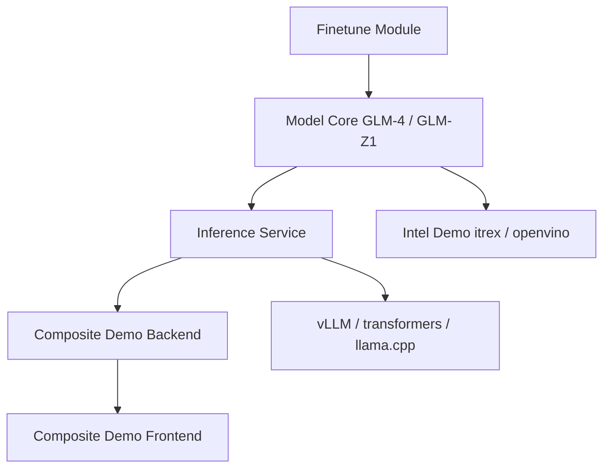

# THUDM/GLM-4

> Family of open models GLM-4-0414 and GLM-Z1 (9B and 32B), with fine-tuning and inference code.

## The problem
Having open, locally sized models (9B, 32B) for chat, code, function calling and reasoning.

## What it actually does
The repository gathers the model cards (Chat, Base, Reasoning, Rumination), inference scripts (CLI, web, batch), a finetune folder (LoRA, optional SwanLab) and two demos (composite, Intel). Native 32K context, YaRN advised beyond. The scores provided are the authors' own.

## How it is wired


## Trying it
```bash
cd finetune
pip install -r ../inference/requirements.txt
pip install -r requirements.txt
python finetune.py  data/AdvertiseGen/  zai-org/GLM-4-9B-0414  configs/lora.yaml
```

## Cost and gotchas
GPU required for the 32B; the 9B targets limited resources. The Rumination model requires an external search engine and ignores system prompts and custom tools. License not declared in the catalog: check each model.

## What it is not
Not a ready-to-use API (hosted services are on Z.ai and bigmodel.cn); benchmarks not cross-checked.

## Alternatives
- No alternative named in the README (it only compares against GPT-4o, DeepSeek and Qwen).

## For you
Watch: an open 9B/32B with LoRA scripts is a credible candidate for your local experiments, to be validated with your own evaluations and after checking the license.
