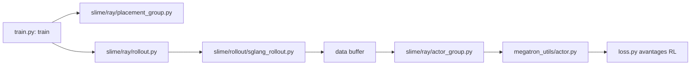

# THUDM/slime

> RL post-training framework linking Megatron for training and SGLang for rollout.

## The problem
RL stacks pile up decoupled trainers, rollout services and agent frameworks, and RL bugs are silent: nothing crashes, the curve is just wrong.

## What it actually does
Runs Megatron training, SGLang rollout, data generation, reward computation and environment interaction through a single training / rollout / Data Buffer path.
Native pass-through: Megatron arguments are read directly, and those of the installed SGLang are exposed with the `--sglang-` prefix.
Separate rollout-only and train-only debug paths, CPU unit tests, contract tests on the hooks, end-to-end GPU tests.
PD Disaggregation, Delta Weight Sync, external rollout engines that can run on other GPUs.

## How it is wired


## Trying it
```bash
apt install pre-commit -y
pre-commit install
pre-commit run --all-files --show-diff-on-failure --color=always
```

## Cost and gotchas
Post-training of large models: this is multi-GPU, and no lightweight version is offered. The README gives no installation command, everything points to the Quick Start Guide. A single rollout backend, SGLang, by deliberate choice.

## What it is not
Not an agent framework: agentic workflows plug in as data generation through `--custom-generate-function-path`, they do not fork the training core. Not multi-backend: vLLM exists, but through the derived project `vime`. The "battle-tested" validations cited concern the authors' own GLM models.

## Alternatives
Dressage, Miles, vime, Relax — four frameworks built *on* slime, cited as an ecosystem, including vime for those who want vLLM rather than SGLang.

## For you
The most readable RL foundation at the moment if you do post-training; worth reading even without a GPU, for its dataflow breakdown.
