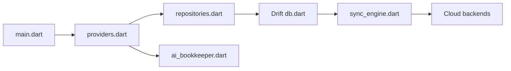

# TNT-Likely/BeeCount

> Flutter mobile personal accounting app, offline first, with self-hostable sync.

## The problem
Budget apps store data with a third party, with ads and paid features.

## What it actually does
Flutter application (Riverpod, Drift/SQLite): multi-account, budgets, CSV imports (Alipay) and AI-assisted entry (text, OCR, voice) via Zhipu's GLM. Sync goes through BeeCount Cloud, iCloud, Supabase, WebDAV or S3. An agent with permissioned tools and an MCP server on the Cloud side are mentioned.

## How it is wired


## Trying it
```bash
flutter pub get
dart run build_runner build --delete-conflicting-outputs
flutter run --flavor dev
flutter build apk --flavor prod --release
```

## Cost and gotchas
AI relies on a cloud GLM model (third-party service key). BSL license: paid commercial use, including within a for-profit organization.

## What it is not
Not free in the strict sense: the README says "Business Source License", which GitHub does not identify. The README is in Chinese, and the Cloud is a separate repository.

## Alternatives
No alternative named in the README.

## For you
Keep an eye on it: a useful example of local-first Flutter with an agent, but the BSL license forbids enterprise use without agreement.
