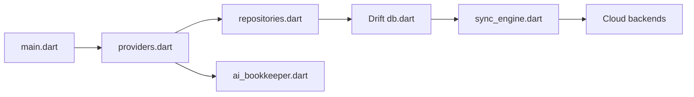

# TNT-Likely/BeeCount

> Application mobile Flutter de comptabilité personnelle, hors ligne d'abord, avec synchronisation auto-hébergeable.

## Le problème
Les applis de budget stockent les données chez un tiers, avec publicité et fonctions payantes.

## Ce que ça fait vraiment
Application Flutter (Riverpod, Drift/SQLite) : multi-comptes, budgets, imports CSV (Alipay) et saisie assistée par IA (texte, OCR, voix) via GLM de Zhipu. La synchro passe par BeeCount Cloud, iCloud, Supabase, WebDAV ou S3. Un agent à outils permissionnés et un serveur MCP côté Cloud sont mentionnés.

## Comment c'est branché


## Essayer
```bash
flutter pub get
dart run build_runner build --delete-conflicting-outputs
flutter run --flavor dev
flutter build apk --flavor prod --release
```

## Coût et pièges
L'IA repose sur un modèle cloud GLM (clé de service tiers). Licence BSL : usage commercial payant, y compris dans une organisation à but lucratif.

## Ce que ce n'est pas
Pas libre au sens strict : le README dit « Business Source License », que GitHub n'identifie pas. Le README est en chinois, le Cloud est un dépôt séparé.

## Alternatives
Aucune alternative nommée dans le README.

## Pour toi
À surveiller : exemple utile de Flutter local-first avec agent, mais la licence BSL interdit l'usage en entreprise sans accord.

