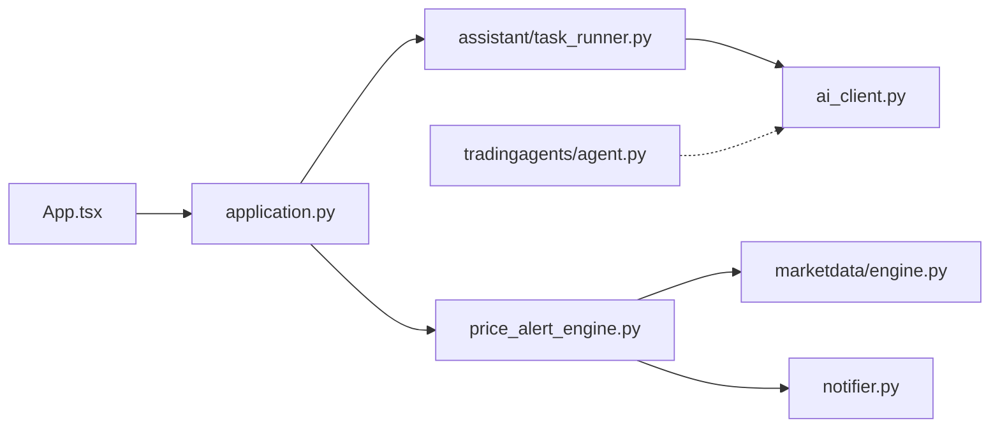

# TNT-Likely/PanWatch

> Self-hosted stock-tracking application, with AI agent analyses and multi-channel alerts.

## The problem
Tracking a portfolio across the A-share, Hong Kong and US markets means cross-checking prices, news and technical indicators all day, with nothing turning them into concrete actions.

## What it actually does
Watchlist, multi-account portfolios, paper trading, price alerts combining conditions with AND/OR, with delays and caps.
Scheduled agents: pre-market, intraday monitoring (RSI, KDJ, MACD), closing report.
Deep analysis via TradingAgents: four analysts, bull/bear debate, risk review, "PM" decision, in 3 to 5 minutes.
Notifications via Telegram, WeCom, DingTalk, Feishu, Bark, webhooks. FastAPI, SQLAlchemy, APScheduler, React; optional OpenTelemetry export with GenAI spans.

## How it is wired


## Trying it
```bash
docker run -d --name panwatch --restart unless-stopped -p 8000:8000 -v panwatch_data:/app/data sunxiao0721/panwatch:latest
docker compose up -d
make dev-api
make dev-web
pip install -r requirements-otel.txt
```

## Cost and gotchas
OpenAI-compatible model at your expense; the README states roughly 0.05 USD per TradingAgents analysis with `deepseek-chat`, Ollama possible. On first start, Chromium (Playwright) is downloaded into the volume, unless `PLAYWRIGHT_SKIP_BROWSER_INSTALL=1`.

## What it is not
Not a broker: the README documents no real order placement, the trading offered is paper trading.
Not reliable advice: the "PM decision" remains an LLM output.
Default timezone is `Asia/Shanghai`, to be changed for your hours.

## Alternatives
- TradingAgents: if you only want the multi-agent analysis, without monitoring or alerts.

## For you
Out of scope unless you invest; its OTel GenAI breakdown (run, LLM call, node) is nonetheless worth reading.
