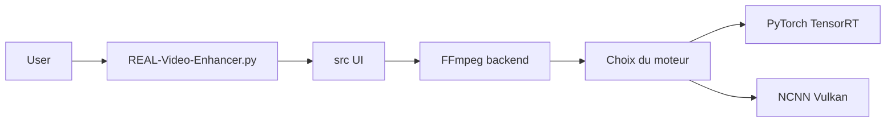

# TNTwise/REAL-Video-Enhancer

> Desktop application to interpolate frames and upscale videos with neural networks.

## The problem
Taking a video from 24 to 48 frames per second or upscaling it requires chaining FFmpeg and complex models.

## What it actually does
A Qt interface drives a Python backend: FFmpeg decodes and encodes, then inference engines (PyTorch, TensorRT, NCNN, ONNX) run interpolation models (RIFE, GMFSS, IFRNet) and upscaling models (SPAN, AnimeJaNai…), with scene change detection and preview. Available on Windows, Linux (executable, Flatpak) and macOS.

## How it is wired


## Trying it
```bash
git clone --recurse-submodules https://github.com/TNTwise/REAL-Video-Enhancer
python3 build.py --build BUILD_OPTION --copy_backend
```

## Cost and gotchas
GPU recommended (Nvidia RTX 20+, 8 GB of VRAM for TensorRT), 16 to 32 GB of RAM. The Windows binary may be flagged as a trojan (a PyInstaller false positive according to the README). AGPL-3.0 license.

## What it is not
Not an online service nor a library: it is an app. TensorRT takes time to optimize on the first video.

## Alternatives
The README cites Flowframes and enhancr as outdated software.

## For you
Worth watching: a good example of multi-backend inference packaging, but a consumer video use case.
