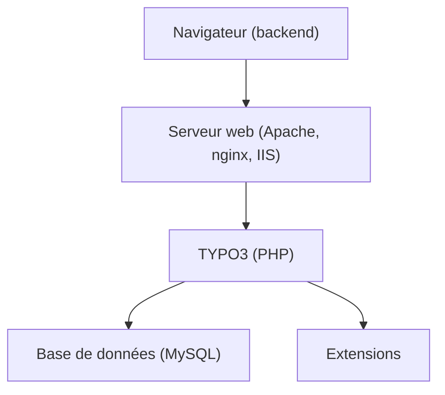

# TYPO3/typo3

> Free PHP content management system under the GPL, extensible through plugins.

## The problem
Publishing and administering a rich website requires a full content back office.

## What it actually does
A PHP "Content Management Framework" with a lightweight core and extensions for the front end and administration, accessible through the browser. It runs on Apache, nginx or IIS, on Linux, Windows, FreeBSD or macOS, with a database such as MySQL.

## How it is wired
Simplified diagram based on the sheet, no diagram provided.



## Trying it
```bash
# Aucune commande documentée : suivre le guide d'installation (INSTALL.md) et le site officiel.
```

## Cost and gotchas
Free, but the README warns that mastering the tool takes time and perseverance. Derivatives must also remain under the GPL.

## What it is not
Not a data or AI tool. The README documents no command and no specific PHP version.

## Alternatives
No alternative named in the README.

## For you
Ignore: a general-purpose web CMS unrelated to data, AI or MLOps.
