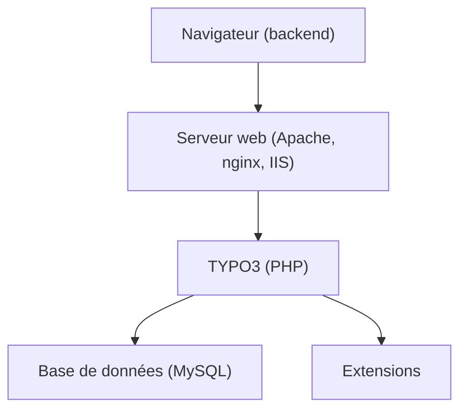

# TYPO3/typo3

> Système de gestion de contenu PHP libre, sous GPL, extensible par plugins.

## Le problème
Publier et administrer un site web riche demande un back-office de contenu complet.

## Ce que ça fait vraiment
Un « Content Management Framework » PHP avec un noyau léger et des extensions pour le front et l'administration, accessible via le navigateur. Il tourne sous Apache, nginx ou IIS, sur Linux, Windows, FreeBSD ou macOS, avec une base comme MySQL.

## Comment c'est branché
Schéma simplifié d'après la fiche, sans diagramme fourni.



## Essayer
```bash
# Aucune commande documentée : suivre le guide d'installation (INSTALL.md) et le site officiel.
```

## Coût et pièges
Gratuit, mais le README prévient qu'il faut du temps et de la persévérance pour maîtriser l'outil. Les dérivés doivent aussi rester en GPL.

## Ce que ce n'est pas
Pas un outil data ou IA. Le README ne documente aucune commande ni version précise de PHP.

## Alternatives
Aucune alternative nommée dans le README.

## Pour toi
Ignorer : CMS web généraliste sans rapport avec la data, l'IA ou le MLOps.

