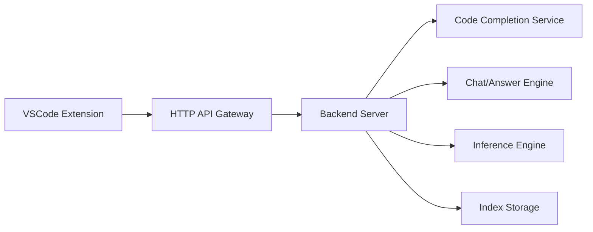

# TabbyML/tabby

> Self-hosted AI code assistant, an alternative to GitHub Copilot, with an OpenAPI interface and consumer-grade GPU support.

## The problem
Getting code completion and chat without sending your code to a cloud service.

## What it actually does
A Rust server that serves completion, chat and an "Answer Engine"; extensions for VSCode, IntelliJ, Vim (Eclipse is mentioned in the diagram). Repository context, indexing of documentation and merge requests, LDAP authentication, self-hosted GitLab and GitHub. According to the README, no DBMS or cloud is required.

## How it is wired


## Trying it
```bash
docker run -it \
  --gpus all -p 8080:8080 -v $HOME/.tabby:/data \
  tabbyml/tabby \
  serve --model StarCoder-1B --device cuda --chat-model Qwen2-1.5B-Instruct
git clone --recurse-submodules https://github.com/TabbyML/tabby
cargo build
```

## Cost and gotchas
Free, but the example needs a GPU (`--gpus all`, CUDA) and the models are downloaded. Last push in June 2026; the latest dated entry in the README is from December 2025. License present but not identified by GitHub.

## What it is not
Not equivalent to Copilot in quality: local models are smaller. Part of the roadmap (agents) is in private preview.

## Alternatives
No alternative named in the README (GitHub Copilot is cited as the reference).

## For you
Worth watching if code privacy requires running locally; check the license and recent activity before committing to it.
