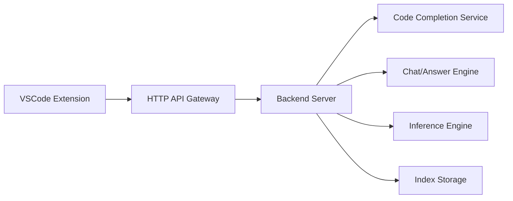

# TabbyML/tabby

> Assistant de code IA auto-hébergé, alternative à GitHub Copilot, avec API OpenAPI et GPU grand public.

## Le problème
Obtenir de la complétion et du chat de code sans envoyer son code à un service cloud.

## Ce que ça fait vraiment
Serveur Rust qui sert complétion, chat et « Answer Engine » ; extensions pour VSCode, IntelliJ, Vim (Eclipse cité dans le schéma). Contexte du dépôt, indexation de documentation et de merge requests, authentification LDAP, GitLab et GitHub auto-hébergés. Sans SGBD ni cloud requis d'après le README.

## Comment c'est branché


## Essayer
```bash
docker run -it \
  --gpus all -p 8080:8080 -v $HOME/.tabby:/data \
  tabbyml/tabby \
  serve --model StarCoder-1B --device cuda --chat-model Qwen2-1.5B-Instruct
git clone --recurse-submodules https://github.com/TabbyML/tabby
cargo build
```

## Coût et pièges
Gratuit, mais il faut un GPU pour l'exemple (`--gpus all`, CUDA) et les modèles se téléchargent. Dernier push en juin 2026 ; la dernière entrée datée du README est de décembre 2025. Licence présente mais non identifiée par GitHub.

## Ce que ce n'est pas
Pas équivalent à Copilot en qualité : les modèles locaux sont plus petits. Une partie de la feuille de route (agents) est en préversion privée.

## Alternatives
Aucune alternative nommée dans le README (GitHub Copilot cité comme référence).

## Pour toi
À surveiller si la confidentialité du code impose du local ; vérifie la licence et l'activité récente avant de t'y engager.

