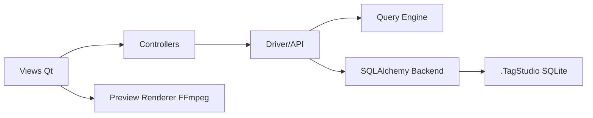

# TagStudioDev/TagStudio

> Desktop application to organize photos and files by tags, without moving the files.

## The problem
Find files in large folders without imposing a hierarchy or proprietary sidecar files.

## What it actually does
A "library" sits on top of an existing folder and stores tags and fields in a SQLite database in `.TagStudio`. Tags with aliases, color and parent tags; search with boolean operators, `path:`, `filetype:` and `mediatype:`; previews of many formats; relinking of moved files. Version Alpha 9.5.5.

## How it is wired

## Trying it
No command documented in the README: download an executable from the GitHub Releases page (Windows, macOS, Linux).

## Cost and gotchas
Free. FFmpeg required for videos, ripgrep recommended. Only the Releases page is official; no package manager. Antivirus false positives reported (PyInstaller).

## What it is not
No cloud integration or remote LLM, excluded by the author. Relinking does not cover renamed files.

## Alternatives
No alternative named in the README.

## For you
Ignore: a personal file manager in alpha, with no direct use in data/AI/MLOps.
