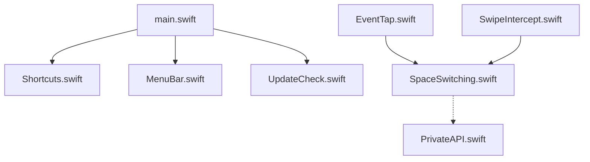

# Tahul/space-rabbit

> Small macOS application that removes the animation when switching Spaces.

## The problem
Every Space switch on macOS plays an animation that wastes time.

## What it actually does
It intercepts the keyboard or trackpad (`EventTap.swift`, `SwipeIntercept.swift`) and requests an instant switch by sending synthetic DockSwipe gestures, via private macOS APIs. It also handles automatic following on Cmd+Tab and Mission Control. An option makes Dock hiding instant.

## How it is wired


## Trying it
```bash
brew install space-rabbit
make app
```

## Cost and gotchas
Free; requires Accessibility access. Building requires the Xcode Command Line Tools. The "Instant Dock hide" option changes a global Dock setting, not restored on removal: a revert command is given in the README. Relies on a private API hack, fragile after a macOS update.

## What it is not
Not a window manager: it only removes animations.

## Alternatives
InstantSpaceSwitcher, whose technique is reused; iss and FasterSwiper, some of whose features are ported.

## For you
Ignore: macOS comfort, unrelated to data, AI or MLOps.
