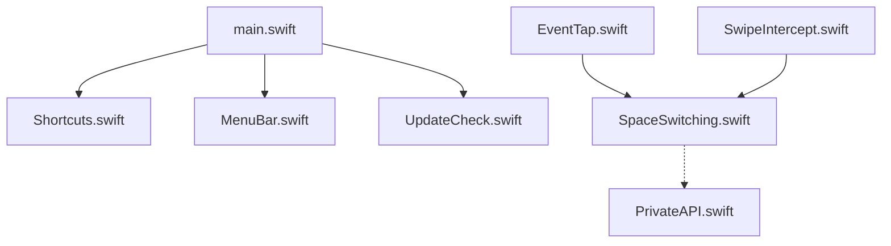

# Tahul/space-rabbit

> Petite application macOS qui supprime l'animation lors du changement de Spaces.

## Le problème
Chaque changement de Space sous macOS joue une animation qui fait perdre du temps.

## Ce que ça fait vraiment
Elle intercepte le clavier ou le trackpad (`EventTap.swift`, `SwipeIntercept.swift`) et demande un basculement instantané en envoyant des gestes DockSwipe synthétiques, via des API privées de macOS. Elle gère aussi le suivi automatique à Cmd+Tab et Mission Control. Une option rend le masquage du Dock instantané.

## Comment c'est branché


## Essayer
```bash
brew install space-rabbit
make app
```

## Coût et pièges
Gratuit ; demande l'accès Accessibilité. Compiler exige les Xcode Command Line Tools. L'option « Instant Dock hide » modifie un réglage global du Dock, non restauré à la suppression : commande de retour fournie dans le README. Repose sur un hack d'API privées, fragile après une mise à jour de macOS.

## Ce que ce n'est pas
Pas un gestionnaire de fenêtres : il ne fait que supprimer des animations.

## Alternatives
InstantSpaceSwitcher, dont la technique est reprise ; iss et FasterSwiper, dont des fonctions sont portées.

## Pour toi
À ignorer : confort macOS, sans lien avec la data, l'IA ou le MLOps.

