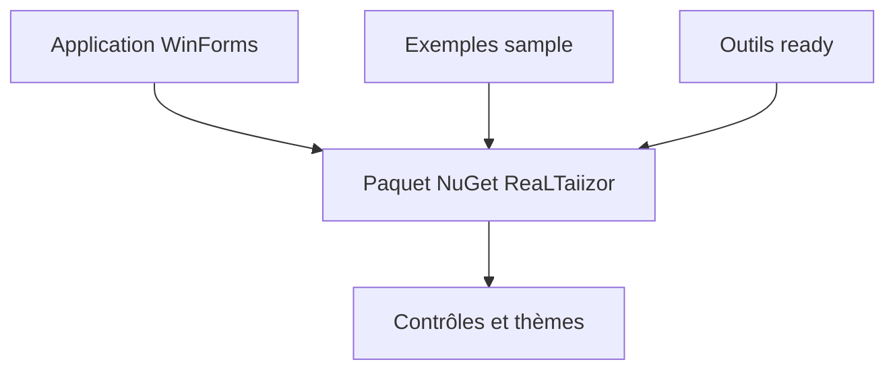

# Taiizor/ReaLTaiizor

> Library of polished .NET WinForms controls, with many themes, for Windows applications.

## The problem
Default WinForms controls look dated and are hard to customize.

## What it actually does
Adds styled components (Material, Metro, Poison, Crown, Parrot, Cyber...) with several themes. Complete examples imitate Rufus, XAMPP, Windows Defender or an MP3 player. Small ready-to-use tools are provided: stopwatch, hashing, MAChanger, port scanner, translation. The README is mostly screenshots.

## How it is wired
Simplified diagram based on the sheet, no diagram provided.


## Trying it
```
Install-Package ReaLTaiizor
```

## Cost and gotchas
Free. Windows and .NET only. The Genshin Impact, Windows Defender or Kaspersky examples imitate third-party interfaces, not to be confused with the actual products. A single maintainer.

## What it is not
Not a cross-platform UI framework: WinForms only.

## Alternatives
No alternative named in the README.

## For you
Ignore: Windows interface decoration, unrelated to data, AI or MLOps.
