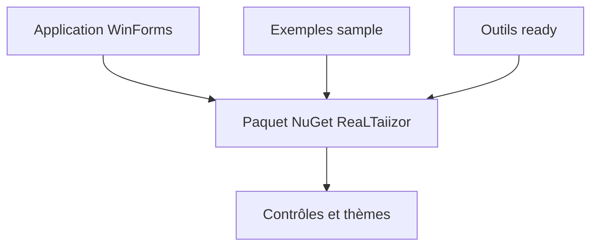

# Taiizor/ReaLTaiizor

> Bibliothèque de contrôles .NET WinForms soignés, avec nombreux thèmes, pour des applications Windows.

## Le problème
Les contrôles WinForms par défaut paraissent datés et peu personnalisables.

## Ce que ça fait vraiment
Ajoute des composants stylisés (Material, Metro, Poison, Crown, Parrot, Cyber...) avec plusieurs thèmes. Des exemples complets imitent Rufus, XAMPP, Windows Defender ou un lecteur MP3. Des petits outils prêts à l'emploi sont fournis : chronomètre, hachage, MAChanger, scanner de ports, traduction. Le README est surtout fait de captures.

## Comment c'est branché
Schéma simplifié d'après la fiche, sans diagramme fourni.


## Essayer
```
Install-Package ReaLTaiizor
```

## Coût et pièges
Gratuit. Windows et .NET uniquement. Les exemples Genshin Impact, Windows Defender ou Kaspersky imitent des interfaces tierces, à ne pas confondre avec les produits. Un seul mainteneur.

## Ce que ce n'est pas
Pas un cadriciel d'interface multiplateforme : seulement WinForms.

## Alternatives
Aucune alternative nommée dans le README.

## Pour toi
À ignorer : décoration d'interfaces Windows, sans lien avec la data, l'IA ou le MLOps.

