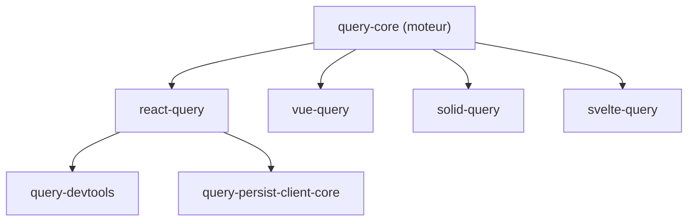

# TanStack/query

> An asynchronous state management library that fetches, caches and synchronizes server data, for front-ends.

## The problem
Loading server data by hand forces you to handle cache, refetching, pagination and errors in every component.

## What it actually does
A central engine (`query-core`) handles queries, cache, background refetching, mutations, pagination and infinite scroll. Adapters plug it into React, Vue, Solid, Svelte and Angular (experimental). Optional packages add persistence and developer tools.

## How it is wired

## Trying it
No command documented in the README provided: it points to the documentation.

## Cost and gotchas
Free. A compatible front-end framework is required. Part of the adapters remains experimental (Angular).

## What it is not
Not a storage tool nor an HTTP client: it manages the state of calls, whatever the protocol (REST, GraphQL, promises).

## Alternatives
No alternative named in the README, which presents other TanStack packages (Router, Table, Store).

## For you
Ignore: relevant only if you build a web interface that consumes your model APIs.
