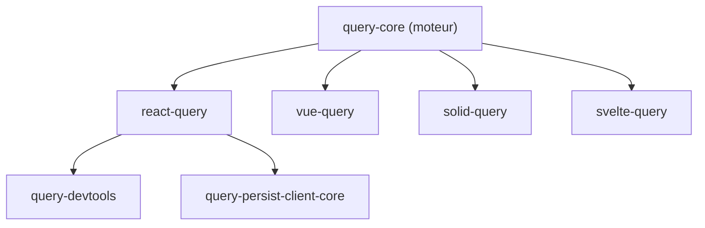

# TanStack/query

> Bibliothèque de gestion d'état asynchrone qui récupère, met en cache et synchronise les données serveur, pour front-end.

## Le problème
Charger des données serveur à la main impose de gérer cache, rechargement, pagination et erreurs dans chaque composant.

## Ce que ça fait vraiment
Un moteur central (`query-core`) gère requêtes, cache, rechargement en arrière-plan, mutations, pagination et défilement infini. Des adaptateurs le branchent à React, Vue, Solid, Svelte et Angular (expérimental). Des paquets optionnels ajoutent la persistance et des outils de développement.

## Comment c'est branché

## Essayer
Aucune commande documentée dans le README fourni : il renvoie à la documentation.

## Coût et pièges
Gratuit. Il faut un framework front-end compatible. Une partie des adaptateurs reste expérimentale (Angular).

## Ce que ce n'est pas
Pas un outil de stockage ni un client HTTP : il gère l'état des appels, quel que soit le protocole (REST, GraphQL, promesses).

## Alternatives
Aucune alternative nommée dans le README, qui présente d'autres paquets TanStack (Router, Table, Store).

## Pour toi
À ignorer : pertinent seulement si tu construis une interface web qui consomme tes API de modèles.

