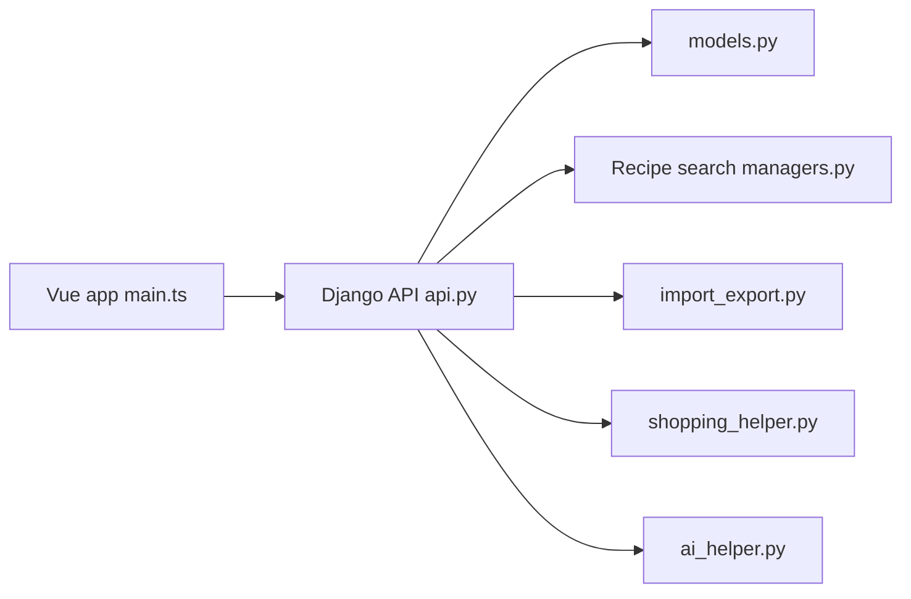

# TandoorRecipes/recipes

> Self-hosted recipe manager with meal planning and shopping lists, for families.

## The problem
A recipe collection scattered across websites and notebooks is hard to search, plan and share.

## What it actually does
Django and Vue application: recipe management, full-text search with trigram similarity, tags, import from thousands of sites (ld+json) and other managers, meal planning, shopping lists, cookbooks, sharing. An AI assistant can read images or sort steps. Dropbox or Nextcloud synchronization.

## How it is wired

## Trying it
No command documented in the README, which points to the documentation (Docker, Kubernetes, Unraid, Synology examples).

## Cost and gotchas
Free; the AI requires a third-party service. Not designed for a public page (basic permissions). License not identified by GitHub.

## What it is not
Not an application open to the general public: the README states that it is meant for sharing with family and friends.

## Alternatives
- No alternative named in the README.

## For you
Ignore: household use outside your field, license to check before any reuse.
