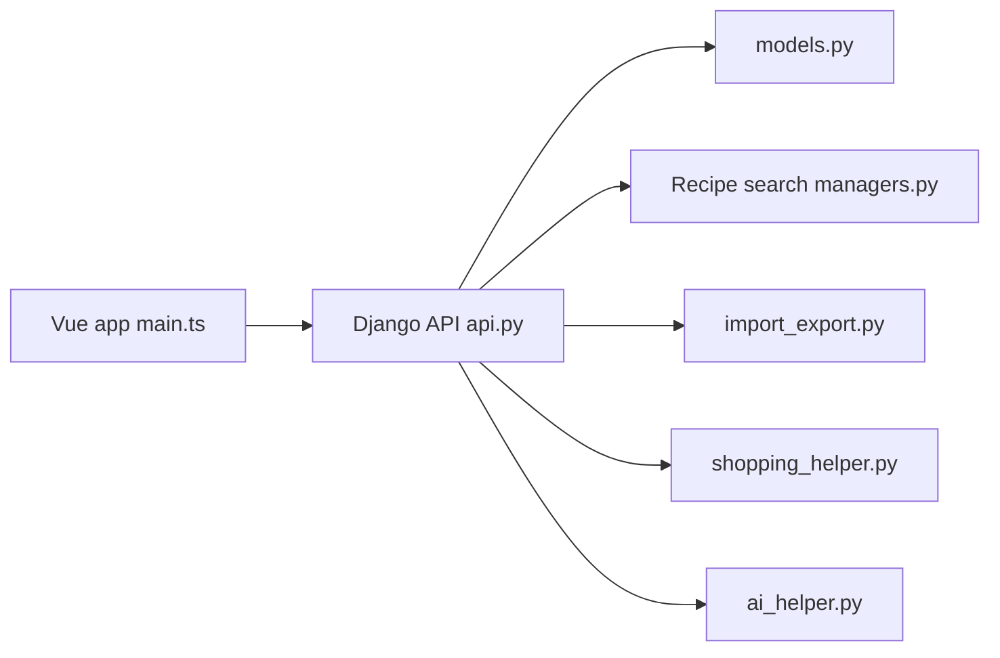

# TandoorRecipes/recipes

> Gestionnaire de recettes auto-hébergé avec planning de repas et listes de courses, pour familles.

## Le problème
Une collection de recettes éparpillée sur des sites web et des carnets est difficile à chercher, planifier et partager.

## Ce que ça fait vraiment
Application Django et Vue : gestion de recettes, recherche plein texte avec similarité trigramme, étiquettes, import depuis des milliers de sites (ld+json) et d'autres gestionnaires, planification de repas, listes de courses, livres de recettes, partage. Une assistance IA peut lire des images ou trier les étapes. Synchronisation Dropbox ou Nextcloud.

## Comment c'est branché

## Essayer
Aucune commande documentée dans le README, qui renvoie à la documentation (exemples Docker, Kubernetes, Unraid, Synology).

## Coût et pièges
Gratuit ; l'IA demande un service tiers. Pas prévu pour une page publique (permissions de base). Licence non identifiée par GitHub.

## Ce que ce n'est pas
Pas une application ouverte au grand public : le README précise qu'elle sert à partager avec famille et amis.

## Alternatives
- Aucune alternative nommée dans le README.

## Pour toi
À ignorer : usage domestique hors domaine, licence à vérifier avant toute réutilisation.

