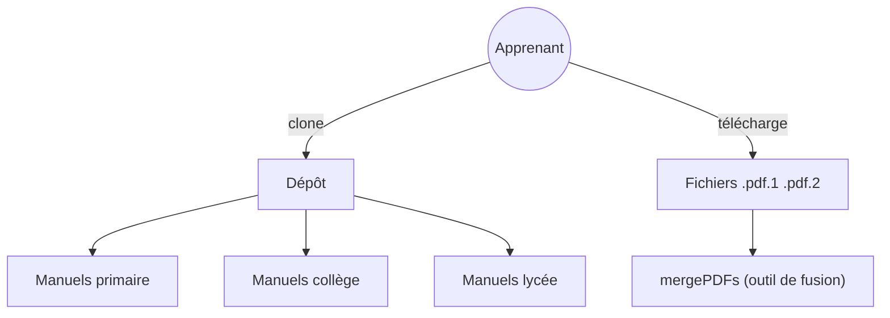

# TapXWorld/ChinaTextbook

> Collection of Chinese school textbooks in PDF, from primary school to university, for students and expatriate families.

## The problem
These free textbooks are hard to access outside China, and some are resold with a watermark. The project centralizes them.

## What it actually does
A repository of PDFs sorted by level, subject, publisher and grade, with a focus on mathematics (primary, middle school, high school, university) and an exercises folder. Files over 50 MB are split into 35 MB chunks (`.pdf.1`, `.pdf.2`) because of GitHub limits, and a provided program glues them back together.

## How it is wired

## Trying it
No command documented: the README asks you to place `mergePDFs-windows-amd64.exe` in the folder of PDF chunks, then run it by double-clicking.

## Cost and gotchas
Very heavy repository to clone. The provided merge tool is a Windows executable. With no declared license, the rights over these publisher textbooks are unclear.

## What it is not
Not a dataset usable for ML: these are raw school PDFs, with no annotation. Not a guaranteed royalty-free source.

## Alternatives
- tchMaterial-parser: to re-download from mainland China with a good connection.

## For you
Ignore: Chinese school content unrelated to your work, and an uncertain rights status.
