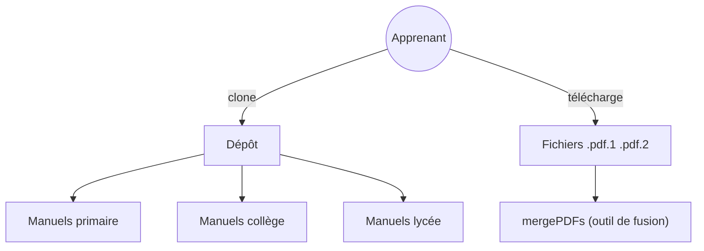

# TapXWorld/ChinaTextbook

> Collection de manuels scolaires chinois en PDF, du primaire à l'université, pour élèves et familles expatriées.

## Le problème
Ces manuels gratuits sont difficiles d'accès hors de Chine, et certains sont revendus avec filigrane. Le projet les centralise.

## Ce que ça fait vraiment
Un dépôt de PDF classés par niveau, matière, éditeur et classe, avec un focus sur les mathématiques (primaire, collège, lycée, université) et un dossier d'exercices. Les fichiers de plus de 50 Mo sont coupés en morceaux de 35 Mo (`.pdf.1`, `.pdf.2`) à cause des limites de GitHub, et un programme fourni les recolle.

## Comment c'est branché

## Essayer
Aucune commande documentée : le README demande de placer `mergePDFs-windows-amd64.exe` dans le dossier des morceaux de PDF, puis de le lancer par double-clic.

## Coût et pièges
Dépôt très lourd à cloner. L'outil de fusion fourni est un exécutable Windows. Sans licence déclarée, les droits sur ces manuels éditeurs ne sont pas clairs.

## Ce que ce n'est pas
Pas un jeu de données exploitable en ML : ce sont des PDF scolaires bruts, sans annotation. Pas une source libre de droits garantie.

## Alternatives
- tchMaterial-parser : pour retélécharger depuis la Chine continentale avec une bonne connexion.

## Pour toi
À ignorer : contenu scolaire chinois sans lien avec ton travail, et statut de droits incertain.

